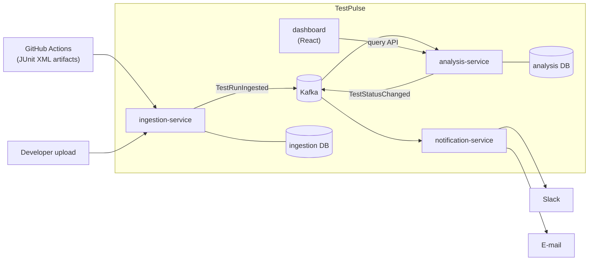

# TestPulse

[](https://github.com/YagmurPazi/testpulse/actions/workflows/ci.yml)
[](LICENSE)


TestPulse detects **flaky tests** from CI test reports and tracks test health over time.

> **Status: Phase 0 (foundation).** The architecture, quality pipeline and local environment are in place.
> The features described below are being built phase by phase; see the [roadmap](#roadmap).

## The problem

A flaky test passes and fails on the same code. Each false failure costs a re-run, a context switch
and a bit of trust in the pipeline, until people start ignoring red builds altogether.

TestPulse will:

- collect JUnit XML (Surefire format) reports from uploads and from GitHub Actions artifacts,
- detect flaky tests statistically, e.g. a test that both passed and failed on the same commit,
  or one that keeps flipping between pass and fail,
- move each test through a lifecycle: `Stable → Suspicious → Flaky → Quarantined`,
- notify the team (Slack, e-mail) when a test changes state,
- show trends on a dashboard.

The value is shown with real data: TestPulse analyses **its own CI runs** and those of open source Java projects.

## Architecture



- **Event-driven:** services communicate through Kafka events, not direct calls ([ADR-0004](docs/adr/0004-kafka-as-event-backbone.md)).
- **Database per service:** one PostgreSQL instance, a separate database and login role per service.
  A service cannot connect to another service's database.
- **Hexagonal inside each service:** the domain is plain Java; frameworks live in adapters.
  The rules are enforced by tests ([ADR-0003](docs/adr/0003-hexagonal-architecture-enforced-by-archunit.md)).

## Quick start

Only Docker is required. No local JDK or Maven needed.

```bash
docker compose up --build
```

| What | Where |
|---|---|
| ingestion-service | http://localhost:8081/actuator/health |
| analysis-service | http://localhost:8082/actuator/health |
| notification-service | http://localhost:8083/actuator/health |
| Mailpit (captured e-mails) | http://localhost:8025 |
| Kafka UI (optional) | http://localhost:8090, start with `docker compose --profile tools up` |

## Development

Requires JDK 21 and Docker (integration tests start real containers).

```bash
./mvnw verify          # full quality pipeline, same as CI
```

```bash
# mutation testing for one service, on demand
./mvnw -pl services/ingestion-service -am test-compile org.pitest:pitest-maven:mutationCoverage
```

### Repository layout

```
architecture-rules/    shared ArchUnit rules, used by every service in test scope
event-contracts/       Kafka event schemas shared by the services
services/
  ingestion-service/   receives reports, publishes TestRunIngested
  analysis-service/    flakiness detection, test state machine, query API
  notification-service/ Slack and e-mail notifications
  Dockerfile           one multi-stage image definition for all services
infra/                 local infrastructure (PostgreSQL init scripts)
config/                Checkstyle and SpotBugs configuration
docs/adr/              architecture decision records
```

Each service follows the same package layout:

```
domain/                  business model and rules, plain Java
application/port/in/     use case interfaces
application/port/out/    what the application needs from outside (storage, messaging)
application/service/     use case implementations
adapter/in/, adapter/out/ web, persistence, messaging
config/                  Spring wiring
```

## Quality gates

Every pull request runs the full pipeline in [GitHub Actions](.github/workflows/ci.yml).

| Gate | Tool | Breaks the build when |
|---|---|---|
| Code style | Checkstyle ([rules](config/checkstyle/checkstyle.xml)) | any violation |
| Architecture | ArchUnit ([shared rules](architecture-rules/src/main/java/io/github/yagmurpazi/testpulse/architecture/HexagonalArchitecture.java)) | the domain depends on a framework, a dependency points outwards, or two adapters depend on each other |
| Unit tests | JUnit 5, Mockito, AssertJ | any failure |
| Integration tests | Testcontainers (PostgreSQL 18) | any failure |
| Static analysis | SpotBugs | a medium or high priority finding |
| Coverage | JaCoCo | report only for now; thresholds in Phase 5 |
| Mutation testing | PIT | on demand for now; thresholds in Phase 5 |
| Container images | Docker Buildx | an image fails to build |

The architecture rules are tested themselves: a compliant sample service must pass and each kind of violation must be
rejected ([tests](architecture-rules/src/test/java/io/github/yagmurpazi/testpulse/architecture/HexagonalArchitectureTest.java)).

**Dogfooding:** CI uploads its JUnit XML reports as the `junit-reports` artifact, also for failed runs.
TestPulse's GitHub importer will analyse them.

## Architecture decisions

Decisions and their trade-offs are recorded in [`docs/adr`](docs/adr/README.md).

| ADR | Decision |
|---|---|
| [0001](docs/adr/0001-record-architecture-decisions.md) | Record architecture decisions |
| [0002](docs/adr/0002-monorepo-with-maven-multi-module.md) | Monorepo with Maven multi-module |
| [0003](docs/adr/0003-hexagonal-architecture-enforced-by-archunit.md) | Hexagonal architecture enforced by ArchUnit |
| [0004](docs/adr/0004-kafka-as-event-backbone.md) | Kafka as the event backbone |

## Known limitations

- **Single Kafka broker** in the local environment, so topics use replication factor 1. A production cluster
  would run at least three brokers.
- **Artifact retention:** GitHub keeps Actions artifacts for at most 90 days, so the importer can only read
  that window of CI history.
- Credentials in `compose.yaml` are for local development only.

## Roadmap

- [x] **Phase 0:** project skeleton, quality pipeline, local environment, first ADRs
- [ ] **Phase 1:** ingestion-service: JUnit XML parsing, upload endpoint, `TestRunIngested` events
- [ ] **Phase 2:** analysis-service: test history, flakiness strategies, test state machine, query API
- [ ] **Phase 3:** dashboard
- [ ] **Phase 4:** notification-service, GitHub Actions importer
- [ ] **Phase 5:** C4 diagrams, coverage and mutation thresholds, demo data and video

## License

[MIT](LICENSE)
