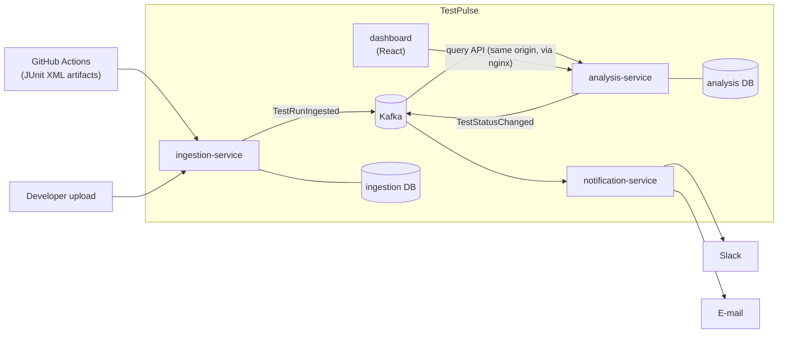

# TestPulse

[](https://github.com/YagmurPazi/testpulse/actions/workflows/ci.yml)
[](LICENSE)


TestPulse detects **flaky tests** from CI test reports and tracks test health over time.

> **Status: Phase 4 (notifications and GitHub importer).** Reports are uploaded or imported from GitHub Actions,
> flaky tests are detected and tracked through their lifecycle, the team is notified by e-mail or Slack, and a
> dashboard shows why each test is flaky. Next: documentation and quality thresholds; see the [roadmap](#roadmap).

## The problem

A flaky test passes and fails on the same code. Each false failure costs a re-run, a context switch
and a bit of trust in the pipeline, until people start ignoring red builds altogether.

TestPulse:

- collects JUnit XML (Surefire format) reports from uploads and from GitHub Actions artifacts,
- detects flaky tests from evidence, e.g. a test that both passed and failed on the same commit,
  or one that keeps flipping between pass and fail ([ADR-0007](docs/adr/0007-flakiness-detection-and-test-status.md)),
- moves each test through a lifecycle: `Stable → Suspicious → Flaky → Quarantined`, with a reason for every change,
- shows each repository's tests, failure trend and the reason behind every status change on a dashboard,
- notifies the team (e-mail, Slack) when a test becomes flaky, is quarantined, released or recovers.

The value is shown with real data: TestPulse analyses **its own CI runs** and those of open source Java projects.

## Architecture



- **Event-driven:** services communicate through Kafka events, not direct calls ([ADR-0004](docs/adr/0004-kafka-as-event-backbone.md)).
- **Database per service:** one PostgreSQL instance, a separate database and login role per service.
  A service cannot connect to another service's database.
- **Hexagonal inside each service:** the domain is plain Java; frameworks live in adapters.
  The rules are enforced by tests ([ADR-0003](docs/adr/0003-hexagonal-architecture-enforced-by-archunit.md)).

## Quick start

Only Docker is required. No local JDK or Maven needed.

```bash
docker compose up --build
```

This builds the services, starts Kafka, PostgreSQL and Mailpit, and uploads the demo runs in [`demo/runs`](demo/runs):
this repository's own CI reports and a small flaky-test story (a test that times out and passes on a re-run of the
same commit).

| What | Where |
|---|---|
| **Dashboard** | http://localhost:3000 |
| ingestion-service | http://localhost:8081/actuator/health |
| analysis-service | http://localhost:8082/actuator/health |
| notification-service | http://localhost:8083/actuator/health |
| Mailpit (notification e-mails) | http://localhost:8025 |
| Kafka UI (optional) | http://localhost:8090, start with `docker compose --profile tools up` |

With the Kafka UI running, the published `TestRunIngested` events are visible under
Topics → `testpulse.test-runs` → Messages.

## Uploading reports

`POST /api/v1/test-runs` takes one or more JUnit XML files (Surefire, Failsafe, Gradle) and the CI metadata:

```bash
curl -F repository=acme/shop -F commitSha=9f2c4e1 -F branch=main \
     -F externalRunId=1234 -F attempt=1 \
     -F reports=@target/surefire-reports/TEST-com.acme.CartTest.xml \
     -F reports=@target/surefire-reports/TEST-com.acme.OrderTest.xml \
     http://localhost:8081/api/v1/test-runs
```

| Field | Required | Notes |
|---|---|---|
| `reports` | yes | one or more files, up to 10 MB each and 50 MB per request |
| `repository` | yes | `owner/name` |
| `commitSha` | yes | 7 to 64 hex characters |
| `branch` | yes | |
| `externalRunId` | no | CI run id; without it, a SHA-256 of the report contents identifies the run |
| `attempt` | no | defaults to 1; a re-run of the same CI run is a new attempt and a new run |

The upload is **idempotent**: `201 Created` for a new run, `200 OK` with the stored run when the same
`(repository, externalRunId, attempt)` arrives again. Errors are RFC 9457 problem details (`application/problem+json`).

`scripts/seed.sh` uploads the demo runs against a running service.

## Analysis results

analysis-service consumes every ingested run, records each test's executions and evaluates it
([ADR-0007](docs/adr/0007-flakiness-detection-and-test-status.md)). On its first start it reads the topic from the
beginning, so runs ingested earlier are analysed too. After `docker compose up`, the demo test
`CheckoutServiceTest.appliesDiscount` is **flaky**:

```bash
curl -s http://localhost:8082/api/v1/repositories/acme/checkout/tests?status=FLAKY
```

| Endpoint | Returns |
|---|---|
| `GET /api/v1/repositories` | repositories with test counts per status |
| `GET /api/v1/repositories/{owner}/{name}/tests?status=` | tests, most severe first, with the reason of the latest change |
| `GET /api/v1/repositories/{owner}/{name}/trend?days=30` | executions, failures and passes-after-rerun per day |
| `GET /api/v1/tests/{id}` | latest executions and the full status history of a test |
| `POST /api/v1/tests/{id}/quarantine` | flaky → quarantined (`409` for any other status) |
| `POST /api/v1/tests/{id}/release` | quarantined → suspicious |

Every status change is also published as a `TestStatusChanged` event on `testpulse.test-status-changes`.

## Notifications

notification-service consumes the status changes and tells the team about the ones that need attention or record a
decision: a test became flaky, was quarantined, released, or recovered ([ADR-0011](docs/adr/0011-notification-delivery.md)).
Changes into and out of *suspicious* and changes older than 24 hours are not notified.

| Channel | Enabled by | Locally |
|---|---|---|
| E-mail | `testpulse.notification.email.enabled` (on), recipients in `testpulse.notification.email.to` | captured by Mailpit, http://localhost:8025 |
| Slack | `SLACK_WEBHOOK_URL`, an [incoming webhook](https://api.slack.com/messaging/webhooks) | `SLACK_WEBHOOK_URL=https://hooks.slack.com/... docker compose up` |

Each channel's delivery is recorded per event, so a redelivered event sends nothing twice and a failing channel
neither blocks nor repeats the others.

## Importing from GitHub Actions

With a GitHub token, ingestion-service imports the JUnit reports of recent workflow runs every 5 minutes, without
any change to the workflows ([ADR-0012](docs/adr/0012-github-actions-importer.md)). It reads the artifacts whose names
start with `junit-reports`, as this repository's CI uploads them:

```bash
GITHUB_TOKEN=$(gh auth token) docker compose up            # analyses this repository's own CI
GITHUB_TOKEN=... GITHUB_REPOSITORIES=owner/a,owner/b docker compose up
```

Without a token the importer is off and TestPulse never calls GitHub. Uploads and imports of the same run are
ingested once.

## Dashboard

http://localhost:3000 shows the same results, without curl:

- **Repositories:** test counts per status, the repositories with flaky tests first.
- **Repository:** failed and passed-after-rerun executions per day (7, 30 or 90 days) and the tests, filtered by
  status. Filters live in the URL, so a filtered view can be shared as a link.
- **Test:** the latest results as a strip, the status history with the reason of every change, the executions per
  commit and attempt, and the quarantine and release actions.

nginx serves the static bundle and proxies `/api/` to analysis-service, so the browser talks to a single origin
([ADR-0009](docs/adr/0009-dashboard-architecture.md)).

## Development

Requires JDK 21 and Docker (integration tests start real containers).

After pulling a version that adds a service database, recreate the local PostgreSQL volume once, since the database
init script only runs on an empty volume: `docker compose down -v`.

```bash
./mvnw verify          # full quality pipeline, same as CI
./mvnw verify -DskipITs -Djacoco.skip   # quick: without Docker, integration tests and the coverage check
```

```bash
# mutation testing for one service (CI runs it for all services)
./mvnw -pl services/ingestion-service -am test-compile org.pitest:pitest-maven:mutationCoverage
```

The dashboard needs Node.js 24 or later ([`.nvmrc`](dashboard/.nvmrc): 26):

```bash
cd dashboard
npm ci
npm run dev            # http://localhost:5173, proxies /api/ to analysis-service on :8082
npm test               # unit, page and accessibility tests (Vitest, MSW, axe)
npm run lint && npm run typecheck
```

```bash
# end-to-end tests against the running stack (docker compose up), once: npx playwright install chromium
cd dashboard && npm run e2e
```

### Repository layout

```
architecture-rules/    shared ArchUnit rules, used by every service in test scope
outbox/                transactional outbox writer and relay, auto-configured in the services that publish
event-contracts/       Kafka event schemas shared by the services
services/
  ingestion-service/   receives reports, publishes TestRunIngested
  analysis-service/    flakiness detection, test state machine, query API
  notification-service/ e-mail and Slack notifications
  Dockerfile           one multi-stage image definition for all services
dashboard/             React single page app, nginx image, Playwright end-to-end tests
infra/                 local infrastructure (PostgreSQL init scripts)
demo/runs/             demo CI runs, uploaded by the seed container
scripts/               seed.sh and other helper scripts
config/                Checkstyle and SpotBugs configuration
docs/adr/              architecture decision records
```

Each service follows the same package layout:

```
domain/                  business model and rules, plain Java
application/port/in/     use case interfaces
application/port/out/    what the application needs from outside (storage, messaging)
application/service/     use case implementations
adapter/in/, adapter/out/ web, persistence, messaging
config/                  Spring wiring
```

## Quality gates

Every pull request runs the full pipeline in [GitHub Actions](.github/workflows/ci.yml).

| Gate | Tool | Breaks the build when |
|---|---|---|
| Code style | Checkstyle ([rules](config/checkstyle/checkstyle.xml)) | any violation |
| Architecture | ArchUnit ([shared rules](architecture-rules/src/main/java/io/github/yagmurpazi/testpulse/architecture/HexagonalArchitecture.java)) | the domain depends on a framework, a dependency points outwards, or two adapters depend on each other |
| Unit tests | JUnit 5, Mockito, AssertJ | any failure |
| Integration tests | Testcontainers (PostgreSQL 18, Kafka 4.4, Mailpit) | any failure |
| Static analysis | SpotBugs | a medium or high priority finding |
| Coverage | JaCoCo (unit and integration tests together), Vitest | services below 95 % of lines or 90 % of branches; dashboard below 92 % / 85 % |
| Mutation testing | PIT on domain and application code | fewer than 90 % of mutants killed |
| Dashboard code | TypeScript (strict), ESLint (type-checked rules, jsx-a11y), Prettier | any error or warning |
| Dashboard tests | Vitest, Testing Library, MSW | any failure, or a request without a mock |
| Accessibility | axe-core in the page tests, axe in Chromium end to end | a WCAG 2.2 A/AA violation |
| End-to-end | Playwright against the compose stack, no retries | any failure |
| Container images | Docker Buildx | an image fails to build |

The architecture rules are tested themselves: a compliant sample service must pass and each kind of violation must be
rejected ([tests](architecture-rules/src/test/java/io/github/yagmurpazi/testpulse/architecture/HexagonalArchitectureTest.java)).

The dashboard's testing strategy is described in [ADR-0010](docs/adr/0010-frontend-testing-strategy.md).

**Dogfooding:** CI uploads its JUnit XML reports (`junit-reports`, `junit-reports-dashboard`, `junit-reports-e2e`)
also for failed runs.
With a token, TestPulse's GitHub importer analyses them.

## Architecture decisions

Decisions and their trade-offs are recorded in [`docs/adr`](docs/adr/README.md).

| ADR | Decision |
|---|---|
| [0001](docs/adr/0001-record-architecture-decisions.md) | Record architecture decisions |
| [0002](docs/adr/0002-monorepo-with-maven-multi-module.md) | Monorepo with Maven multi-module |
| [0003](docs/adr/0003-hexagonal-architecture-enforced-by-archunit.md) | Hexagonal architecture enforced by ArchUnit |
| [0004](docs/adr/0004-kafka-as-event-backbone.md) | Kafka as the event backbone |
| [0005](docs/adr/0005-event-contracts-and-wire-format.md) | Event contracts and wire format |
| [0006](docs/adr/0006-transactional-outbox.md) | Transactional outbox for publishing events |
| [0007](docs/adr/0007-flakiness-detection-and-test-status.md) | Flakiness detection and the test status lifecycle |
| [0008](docs/adr/0008-idempotent-consumer-and-error-handling.md) | Idempotent event consumption and error handling |
| [0009](docs/adr/0009-dashboard-architecture.md) | Dashboard architecture: single page app behind a same-origin proxy |
| [0010](docs/adr/0010-frontend-testing-strategy.md) | Frontend testing strategy |
| [0011](docs/adr/0011-notification-delivery.md) | Notification delivery: what is notified, idempotency per channel, bounded retries |
| [0012](docs/adr/0012-github-actions-importer.md) | Importing CI runs from GitHub Actions by polling |

## Known limitations

- **Single Kafka broker** in the local environment, so topics use replication factor 1. A production cluster
  would run at least three brokers.
- **Artifact retention:** GitHub keeps Actions artifacts for at most 90 days, so the importer can only read
  that window of CI history.
- Credentials in `compose.yaml` are for local development only, and the upload API has no authentication.
  A deployment would need at least API keys per repository.
- **At-least-once delivery:** an event can reach Kafka twice after a failure; consumers deduplicate on its `eventId`
  ([ADR-0006](docs/adr/0006-transactional-outbox.md)).
- Records that can never be processed are skipped and only logged; a dead letter topic is planned after the MVP
  ([ADR-0008](docs/adr/0008-idempotent-consumer-and-error-handling.md)). Notifications that cannot be delivered for
  about a minute are given up the same way ([ADR-0011](docs/adr/0011-notification-delivery.md)).
- Notifications go to one list of recipients; there is no routing per repository or team yet.
- A renamed test starts a new history, and manual quarantines live in the database, not in the event stream.
- The dashboard refreshes on navigation and focus, not live, and its API types are written by hand
  ([ADR-0009](docs/adr/0009-dashboard-architecture.md)).

## Roadmap

- [x] **Phase 0:** project skeleton, quality pipeline, local environment, first ADRs
- [x] **Phase 1:** ingestion-service: JUnit XML parsing, upload endpoint, `TestRunIngested` events via outbox
- [x] **Phase 2:** analysis-service: test history, flakiness strategies, test state machine, query API
- [x] **Phase 3:** dashboard: repositories, trends, test history, quarantine; accessibility and end-to-end tests
- [x] **Phase 4:** notification-service (e-mail, Slack), GitHub Actions importer
- [ ] **Phase 5:** C4 diagrams, coverage and mutation thresholds, demo data and video

## License

[MIT](LICENSE)
