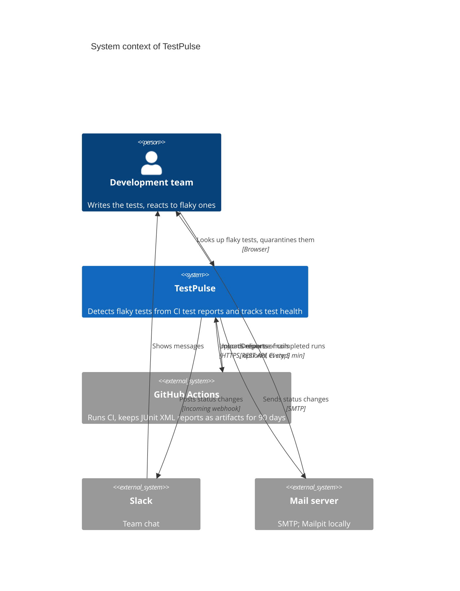
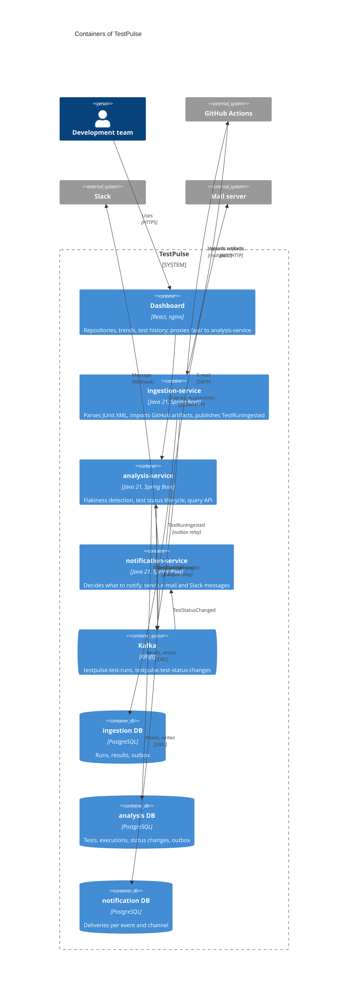
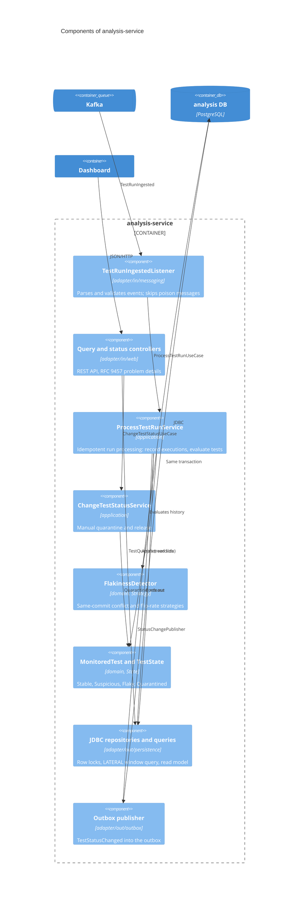
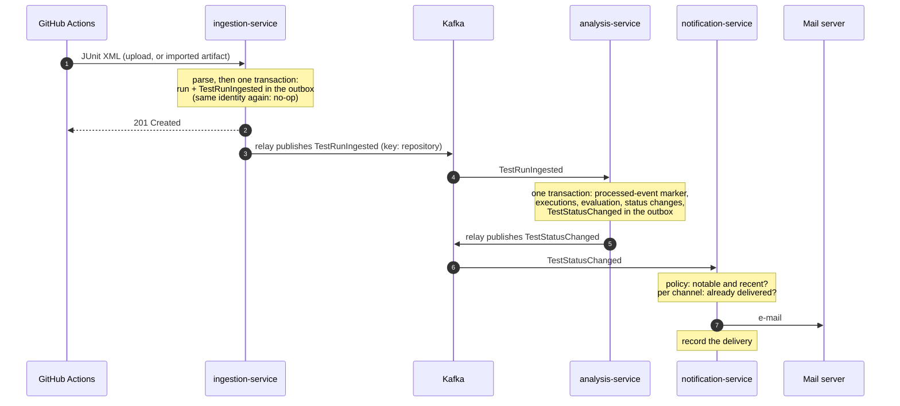

# Architecture

TestPulse is described here with the [C4 model](https://c4model.com): the system in its environment, the containers it
consists of, and the components inside one of them. Decisions behind the structure are in the
[architecture decision records](adr/README.md).

## Level 1: System context

## Level 2: Containers

- **Event-driven:** the services never call each other; they exchange events through Kafka
  ([ADR-0004](adr/0004-kafka-as-event-backbone.md)). A service that is down misses nothing: it reads on when it is back.
- **Database per service:** one PostgreSQL instance, three databases and three login roles. No service can read another
  service's data.
- **Transactional outbox:** a service stores its events with its data in one transaction and a relay publishes them
  ([ADR-0006](adr/0006-transactional-outbox.md)), so data and events never disagree.

## Level 3: Components of analysis-service

Every service has the same hexagonal structure ([ADR-0003](adr/0003-hexagonal-architecture-enforced-by-archunit.md));
analysis-service holds the most logic.

ArchUnit checks the arrows that matter: the domain and application code depend on no framework, adapters do not depend
on each other, and nothing depends on the configuration.

## One run through the system

What happens between a CI run and an e-mail, with the guarantees at each step.

| Step | Failure | What happens |
|---|---|---|
| 2 | the same run is uploaded twice | the identity exists, the stored run is returned, no event ([ADR-0005](adr/0005-event-contracts-and-wire-format.md)) |
| 4 | Kafka is down | events wait in the outbox and are published when it is back |
| 4 | Kafka can never accept an event (above its message limit) | marked rejected and logged; the events behind it continue. Large runs are split into parts so this does not happen in practice ([ADR-0013](adr/0013-large-runs-and-rejected-events.md)) |
| 5 | an event arrives twice | the processed-event marker makes the second one a no-op ([ADR-0008](adr/0008-idempotent-consumer-and-error-handling.md)) |
| 5 | an event can never be processed | skipped and logged, the partition continues |
| 5 | the analysis database is down | retried without limit: nothing is lost, the order is kept |
| 8 | the mail server is down | retried for about a minute, then given up ([ADR-0011](adr/0011-notification-delivery.md)) |

Events of one repository share a Kafka partition, so each repository's runs and status changes are processed in order.

## Topics

| Topic | Producer | Consumers | Key | Partitions | Retention |
|---|---|---|---|---|---|
| `testpulse.test-runs` | ingestion-service | analysis-service | repository | 3 | forever: replay rebuilds the analysis |
| `testpulse.test-status-changes` | analysis-service | notification-service | repository | 3 | 30 days |
